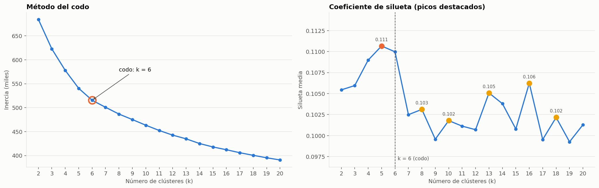
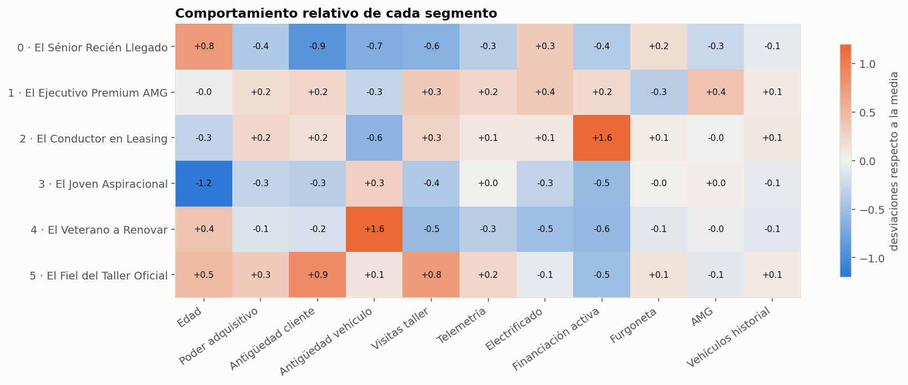
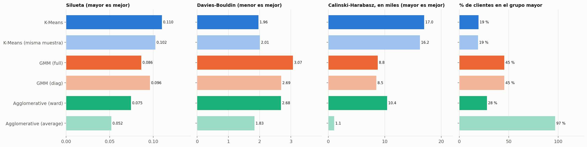
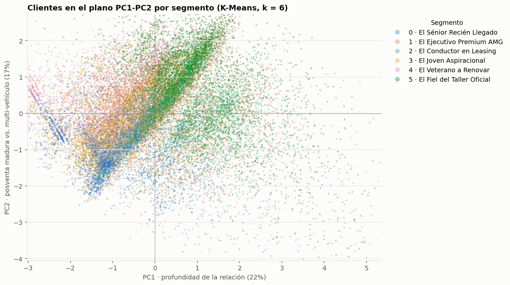

# Clustering the Star · Malackathon 2026 (Mercedes-Benz)

Segmentación de la base de clientes de Mercedes-Benz (Suiza y Austria) con **K-Means** para habilitar
ofertas de vehículos, planes de mantenimiento, campañas de fidelización y comunicaciones dirigidas.

Este repositorio cubre los **4 retos básicos** y los **retos avanzados 1 (comparativa de algoritmos) y 2 (PCA)**. El reto avanzado 3 (Jackknife) se añadirá después.

## Estructura

```
notebooks/
  01_eda.ipynb                  Reto 1 · Exploración y calidad de datos
  02_feature_engineering.ipynb  Reto 2 · Tratamiento de nulos, features derivadas (con SQL), selección
                                y pipeline completo → data/clientes_features.csv, data/X_model_fe2.pkl
  03_kmeans.ipynb               Reto 3 · K-Means con k = 2…20: codo, silueta, Davies-Bouldin,
                                k = 6 justificado y distribución → data/clientes_clusters.csv
  04_segmentos.ipynb            Reto 4 · Perfilado de los 6 segmentos, buyer personas, KPIs de valor, mapa de oportunidades y campañas
  avanzado_1_comparativa.ipynb  Reto avanzado 1 · K-Means frente a GMM, Agglomerative y DBSCAN con k = 6
  avanzado_2_pca.ipynb          Reto avanzado 2 · PCA (2D y 3D), varianza explicada, loadings y separabilidad de los clústeres
  _build_fe2.py                 Genera el notebook 02_feature_engineering
  _build_kmeans2.py             Genera el notebook 03_kmeans
  _build_segmentos2.py          Genera el notebook 04_segmentos
  _build_comparativa.py         Genera el notebook avanzado_1_comparativa
  _build_pca.py                 Genera el notebook avanzado_2_pca
  _build_notebooks.py           Utilidades comunes para los generadores (ya no genera notebooks)
src/
  plot_style.py                 Estilo común de gráficos
  mb_features.py                Constantes compartidas (gamas, edades) y funciones de la primera versión
reports/
  figures/                      Gráficos exportados
  fe2_tratamiento_nulos.csv     Cómo se ha tratado cada columna
  fe2_features_modelo.csv       Features del modelo y su codificación
  kmeans2_metricas_k.csv        Métricas de K-Means para k = 2…20
  fichas_segmentos_k6.csv       Acciones por segmento para marketing
```

## Cómo reproducir

Los datos **no** se suben al repositorio (datos reales de clientes, ~100 MB). Coloca
`datos_reto_mercedes_benz_malackathon.csv` en la raíz del repo o en `data/` y ejecuta los notebooks en orden:

```bash
pip install -r requirements.txt duckdb
jupyter nbconvert --to notebook --execute --inplace notebooks/01_eda.ipynb notebooks/02_feature_engineering.ipynb \
    notebooks/03_kmeans.ipynb notebooks/04_segmentos.ipynb
```

El 02 guarda en `data/` la tabla de clientes y la matriz del modelo, el 03 añade el clúster de cada cliente y el 04 lo interpreta.

## Reto 1 · EDA

Cada fila del CSV es una relación **cliente-vehículo** (302.850 filas, 173.456 clientes). Como se segmentan clientes, el modelo trabaja con
**una fila por cliente**. Los clientes son mayoritariamente de Suiza (66 %), de edad media-alta (61 % con 45 años o más), con un único vehículo
conectado (81 %) y un poder adquisitivo de zona muy alto. El notebook detalla los problemas de calidad y propone su tratamiento.

## Reto 2 · Feature engineering

- **Nulos:** cada columna según su naturaleza. Motor, combustible y clase se deducen con reglas validadas (ocultando valores conocidos); lo que
  no se puede deducir queda como `UNKNOWN`, nunca como "combustión por defecto". Las variables de contexto se imputan con la mediana de un grupo
  comparable y se marcan; la telemetría se resume en `has_telemetry`.
- **Features derivadas** (con su SQL, comprobado con DuckDB): `main_vehicle_age_years`, `tenure_years`, `itvs_passed_count`,
  `warranty_visit_frequency`, `has_telemetry`, `urban_density_classification`, `digital_engagement_index` y `main_is_van`.
- **Modelo:** 11 features (antigüedad del vehículo y como cliente, uso del taller, conectividad, poder adquisitivo, edad, gama, furgoneta,
  telemetría, financiación y motorización) → 18 columnas tras codificar, con `log1p` + `RobustScaler` y one-hot, todo en un `Pipeline`.

## Reto 3 · K-Means



Se exploran k = 2…20. El **codo** y el mejor **Davies-Bouldin** están en k = 6, y la **silueta** de k = 6 (0,110) está a menos de una milésima
del máximo (k = 5). Se elige **k = 6**: seis segmentos equilibrados (entre el 12 % y el 19 % de los clientes) que incluyen un grupo propio de
clientes con el vehículo más antiguo, el público de las campañas de renovación.

## Reto 4 · Segmentos



| Segmento | Peso | Quiénes son | Acción principal |
|---|---|---|---|
| **El Sénior Recién Llegado** | 16,9 % | Mayores de 55 años que acaban de llegar a la marca, con coche muy reciente y muchos electrificados | Bienvenida acompañada y primer plan de mantenimiento |
| **El Ejecutivo Premium AMG** | 15,1 % | Gama alta (GLE/GLS, Clase E), un 27 % AMG, más híbridos enchufables | Upsell a AMG, EQS y Maybach; servicio concierge |
| **El Conductor en Leasing** | 18,4 % | 35-44 años, más del 90 % con financiación activa, coche reciente | Renovación encadenada al fin del contrato |
| **El Joven Aspiracional** | 17,8 % | Los más jóvenes, compactos con unos 5 años, casi nunca financian | Primera financiación y vehículos de ocasión certificados |
| **El Veterano a Renovar** | 12,4 % | Vehículo de unos 9 años, casi todo combustión, sin financiación y con riesgo de fuga | Plan de cambio con tasación y recuperación de posventa |
| **El Fiel del Taller Oficial** | 19,3 % | Los clientes más antiguos y con más poder adquisitivo; los que más usan el taller; compran al contado | Programa VIP y extensión de garantía |

La ficha completa de cada segmento está en el notebook `04_segmentos.ipynb`, con sus KPIs (`reports/kpis_segmentos_k6.csv`) y campañas cuantificadas (`reports/campanas_segmentos_k6.csv`).

## Reto avanzado 1 · Comparativa de algoritmos



Con k = 6 y los mismos datos, **K-Means** obtiene la mejor silueta (0,110) y el mejor Calinski-Harabasz, con segmentos equilibrados.
El **GMM** se desvía hacia las columnas 0/1 (financiación y motorización) y concentra el 45 % de los clientes en un grupo; **Agglomerative**
solo cabe en memoria con una muestra (Ward: silueta 0,075; `average` degenera en un grupo con el 97 %); **DBSCAN** no permite fijar k y funde a
casi todos los clientes en un grupo. Los segmentos cambian mucho entre algoritmos (ARI frente a K-Means ≤ 0,22), mientras que K-Means entrenado
con una muestra reproduce sus propios segmentos (ARI 0,79). Conclusión: K-Means es el algoritmo más adecuado.

## Reto avanzado 2 · PCA



PCA sobre 12 features de negocio (log1p + `StandardScaler`): PC1 explica el 22,5 %, PC2 el 16,7 % y PC3 el 12,5 %
(39,2 % en 2D y 51,7 % en 3D). **PC1** mide la profundidad de la relación con la marca (antigüedad, vehículos, conectividad, taller) y
**PC2** enfrenta al cliente maduro de posventa con el multi-vehículo. Los centros de los clústeres caen en zonas distintas del plano, pero sus
nubes se solapan (silueta ≈ 0 en el espacio del PCA): los clientes forman un continuo de perfiles.

