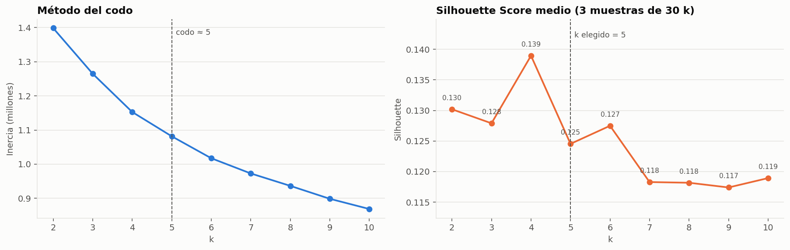
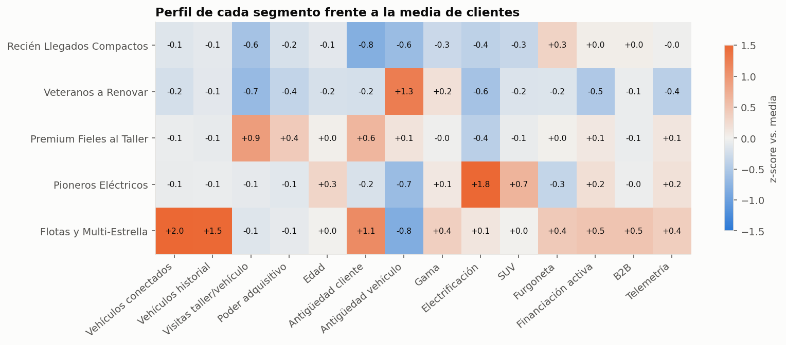

# Clustering the Star · Malackathon 2026 (Mercedes-Benz)

Segmentación de la base de clientes de Mercedes-Benz (Suiza y Austria) con **K-Means** para habilitar
ofertas de vehículos, planes de mantenimiento, campañas de fidelización y comunicaciones dirigidas.

Este repositorio cubre los **4 retos básicos**. Los retos avanzados (comparativa de algoritmos, PCA y Jackknife) se añadirán después.

## Estructura

```
notebooks/
  01_eda.ipynb                  Reto 1 · Exploración y calidad de datos
  01b_tratamiento_nulos.ipynb   Reto 1 · Tratamiento de nulos columna a columna → data/datos_limpios.csv
  02_feature_engineering.ipynb  Reto 2 · Selección de features, features derivadas y pipeline
  03_kmeans.ipynb               Reto 3 · K-Means, método del codo, Silhouette, k final
  04_segmentos.ipynb            Reto 4 · Perfilado y nombres de negocio de los segmentos
  _build_notebooks.py           Genera los notebooks 01-04 (fuente de las celdas)
  _build_nulos.py               Genera el notebook 01b
src/
  mb_features.py                Limpieza, agregación a cliente, features derivadas y pipeline sklearn
  plot_style.py                 Estilo común de gráficos
reports/
  figures/                      Gráficos exportados
  fichas_segmentos.csv          Ficha de acciones por segmento para marketing
  kmeans_metricas_k.csv         Inercia y Silhouette para k = 2…10
  tratamiento_nulos_resumen.csv Cómo se ha tratado cada columna (nulos antes/después y criterio)
```

## Cómo reproducir

Los datos **no** se suben al repositorio (datos reales de clientes, ~100 MB). Coloca
`datos_reto_mercedes_benz_malackathon.csv` en la raíz del repo o en `data/` y ejecuta:

```bash
pip install -r requirements.txt
jupyter nbconvert --to notebook --execute --inplace notebooks/0*.ipynb
```

Los notebooks se ejecutan en orden: el 02 guarda en `data/` la tabla de clientes y la matriz del modelo que usan el 03 y el 04.

## Reto 1 · EDA: hallazgos principales

**Granularidad.** Cada fila es una relación **cliente-vehículo** (302.850 filas → 173.456 clientes, 244.519 vehículos).
Como se segmentan clientes, todo se agrega a **1 fila por cliente** con su "vehículo principal" (el actual más reciente) y agregados de historial.

**¿Cómo es el cliente?**
- 66 % Suiza / 34 % Austria, con poder adquisitivo por hogar muy alto (mediana ≈ 100 k€; Suiza ≈ 116 k€ frente a ≈ 67 k€ en Austria).
- Edad media-alta: el 61 % tiene 45+ años; menos del 5 % tiene menos de 25. Un 78 % de los clientes con género inferido son hombres.
- Relación reciente: mediana de 3 años como cliente conectado. El 81 % tiene un solo vehículo conectado y el 10 % ninguno (posible fuga).
- Producto: dominan GLC, Clase C, Clase A y GLA/GLB; el 34 % conduce un SUV y el 22 % un PHEV/EV.
- El 26 % tiene financiación/leasing activo. El 81 % acepta los tres canales de comunicación.

**Problemas de calidad y cómo se han resuelto**

| Problema | Tratamiento |
|---|---|
| Granularidad mixta cliente-vehículo | Agregación a cliente |
| Telemetría (`trip_*`, `speed_*`, horas, consumo) con ~60 % de nulos | Fuera del modelo; solo se usa para perfilar |
| `engine_concept` nulo al 44 % | Inferido desde `vehicle_type` (`EQ*` → EV, `e`/`de` → PHEV); 94,5 % de acierto validado → 0,3 % nulo |
| `model_class` nulo (1,1 %) | Inferido desde el prefijo de `vehicle_type` |
| Socioeconómicas nulas (6 %), población = 0 | A nulo e imputación por mediana |
| Fechas de matriculación de 1987 | A nulo e imputación por mediana |
| IDs, índice exportado, código postal, modas multivalor, contadores técnicos | Excluidos |
| `gender_derived` (inferido, 11 % nulo) | Fuera del modelo por sesgo; solo se usa para perfilar |

### Tratamiento de nulos (`01b_tratamiento_nulos.ipynb`)

Cada columna se trata según su naturaleza, y cada deducción se **valida** escondiendo valores conocidos:

| Columna(s) | Tratamiento |
|---|---|
| `engine_concept` (44 %) | Cascada validada: reglas por nombre (`EQ…` → eléctrico, `e`/`de` → PHEV), nombre + año, nombre, serie + año, clase + año. Acierta ≈100 % cuando decide; el 25 % de los nulos queda `UNKNOWN` (nunca "combustión por defecto") |
| `fuel_type` (59 %) | Reglas validadas (eléctrico, nombre diésel) + mismo modelo con mismo motor. Gasolina vs gasolina plus no es deducible → ~49 % de los nulos queda `UNKNOWN` |
| `model_class` (1 %) | Deducida del nombre del coche (exacto o prefijo) |
| `date_of_first_registration` (1,4 %) | Mediana de la serie del modelo (error ~1,3 años frente a 2,3 de la mediana global) |
| `gender_derived` (11 %) | `UNKNOWN`: el nulo no es aleatorio y el dato es inferido |
| `vehicle_type`, `zipcode` | `UNKNOWN`: identificadores no reconstruibles |
| Socioeconómicas (6 %) | Mediana **por país**; `purchasing_power_millions_eur` se recalcula con su identidad exacta |
| Telemetría (~60 %, falta estructural) | Indicadores `has_*` de presencia real; contadores → 0, modas → `NO_DATA`, resto → mediana de un grupo comparable |

El CSV limpio (`data/datos_limpios.csv`, 0 nulos, 38 columnas originales + 10 indicadores) se genera al ejecutar el notebook y **no se sube** al repositorio.

## Reto 2 · Features

Pipeline `sklearn`: `ClientAggregator` (limpieza + agregación + features derivadas) → `ColumnTransformer`
(imputación por mediana · `log1p` en conteos y dinero · `StandardScaler` · binarias 0/1).

| Feature | Tipo | Justificación |
|---|---|---|
| `currently_connected_vehicles` | log + escala | Tamaño de la cuenta (particular vs. flota) |
| `n_vehicles_history` *(derivada)* | log + escala | Recurrencia de compra |
| `workshop_visits_per_vehicle` *(derivada)* | log + escala | Uso de posventa → planes de mantenimiento |
| `purchasing_power_per_household_eur` | log + escala | Capacidad de compra de la zona |
| `age_ord` *(derivada)* | ordinal + escala | Etapa vital |
| `tenure_years` *(derivada)* | escala | Antigüedad → fidelización |
| `main_vehicle_age_years` *(derivada)* | escala | **Antigüedad del vehículo** → ventana de renovación |
| `main_segment_tier` *(derivada)* | ordinal + escala | Gama 1-4 → nivel de oferta |
| `main_electrification` *(derivada)* | ordinal + escala | Afinidad eléctrica |
| `is_b2b` *(derivada)* | binaria | Empresa vs. particular |
| `main_is_van` *(derivada)* | binaria | Uso profesional / familiar |
| `finance_active` *(derivada)* | binaria | Contrato vivo con Mercedes-Benz Financial |

El país, el género, los consentimientos y la telemetría se dejan fuera del modelo y se usan para perfilar
(justificación detallada en el notebook 02).

## Reto 3 · K-Means

Se prueba k = 2…10 (inercia con todos los datos; Silhouette promediado sobre 3 muestras de 30.000 clientes).



- El método del codo (kneedle) señala **k = 5**.
- El Silhouette es modesto en todo el rango (0,12-0,14): los clientes forman un continuo, como es habitual en datos reales.
  k = 4 (0,139) y k = 5 (0,125) están prácticamente empatados.
- **Elegimos k = 5**: coincide con el codo, el Silhouette está en la zona alta y aparece un segmento propio de
  "vehículo veterano / ventana de renovación" que con k = 4 queda mezclado con los clientes nuevos. Todos los clusters superan el 5 % de la base.

## Reto 4 · Segmentos



| Segmento | Peso | Quiénes son | Acción principal |
|---|---|---|---|
| 🟦 **Recién Llegados Compactos** | 22 % | Clientes nuevos (≈1,4 años) con coche reciente de gama compacta; aún apenas usan el taller | Onboarding digital, primer plan de mantenimiento, upgrade a gama media |
| 🟧 **Veteranos a Renovar** | 21 % | Coche de ~8 años sin financiación de la marca, poco taller oficial, menor poder adquisitivo; el segmento más joven y con más riesgo de fuga | Plan renove, seminuevos con financiación, recuperación de posventa |
| 🟩 **Premium Fieles al Taller** | 32 % | 89 % Suiza, mayor poder adquisitivo, ≈4 años de cliente y ≈4 visitas al taller por vehículo, más AMG | Mantenimiento premium, programa VIP, upsell a gama superior / AMG |
| 🟨 **Pioneros Eléctricos** | 19 % | 96 % PHEV/EV (51 % eléctrico puro), 65 % SUV, el segmento de más edad | Ecosistema de carga, servicios digitales, renovación hacia la gama EQ |
| 🟥 **Flotas y Multi-Estrella** | 5,5 % | ≈2,8 vehículos conectados, ≈10 en su historial, más B2B y furgonetas, 48 % con financiación | Gestor de cuenta, leasing y mantenimiento de flota, electrificación de vans |

La ficha completa por segmento (ofertas, mantenimiento, fidelización, canal) está en `reports/fichas_segmentos.csv` y en el notebook 04.
